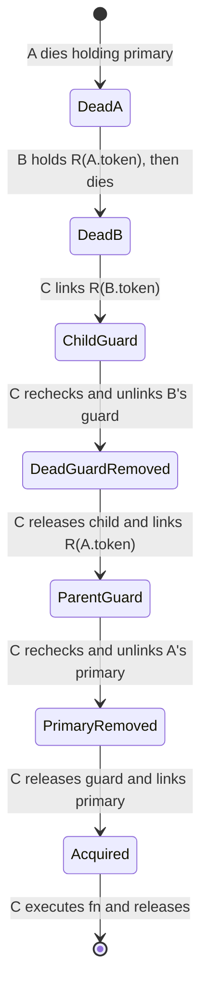

# F1 repair verification — 2026-10-31

Branch: `codex/fix-store-lock-wedge`, based on `7239ce8879adbeea6059bdd6b520474dd44f07e4`.
Product/test commit: `dcc2f34f21b94e205e5f80bc63e4b2b4dbc1f143`.
The model/skill is committed separately; `coverage.json.sync_commit` intentionally identifies the product source snapshot.

## Design and final scope

Keep the existing hard-link acquisition, PID checks, token rechecks, two-attempt loop, public API, and release behavior. Replace the ownerless mkdir recovery guard with a generation-scoped lock in `lock-recovery/` using the same helper recursively. Hash only the dead owner's token: a raw home path would split recovery guards when callers use symlink aliases of the same CODEX_HOME.

The alternatives table, references, finite-chain progress argument, await mapping, and assumptions are in [SKILL.md](SKILL.md). Age/lease deletion can expel a live paused process; fencing would require caller/resource changes. Metadata written after mkdir has a crash gap; directly reclaiming an atomic metadata guard has its own check/delete race. Rename alone cannot compare the source's generation with an earlier read. A native OS-lock replacement is broader than F1.

Legacy `.recover` directories are left alone and ignored. Old CLI versions, including supervisors using saved CLI copies, must finish before the new protocol is used with the same CODEX_HOME. They do not share the new guard and cannot safely coexist. This boundary was explicitly accepted by the user. It is stated beside the product code and in the skill.

Only `src/store.mjs`, `test/store-lock.test.mjs`, and this verification skill are changed. `src/runtime.mjs` is unchanged. The pre-existing `verify-codexteer` skill remains untracked and untouched. No push, PR, deployment, Desktop action, or real CODEX_HOME lock/state manipulation is part of this change.

## Model and trace review

Safety: four concurrent callers, at most three crashes, two attempts per helper frame. Includes the recovery holders themselves and release read/unlink windows. Directory checks/private I/O refine to independent stuttering awaits; shared lstat/readFile/read-check/unlink are separated. Invocation serials give distinct tokens to recursive and repeated recovery calls.

Temporal P3: three ordinary callers plus one fresh non-crashing probe, at most three ordinary-caller crashes, one fresh call, two attempts per recursive frame. The probe starts after all ordinary callers are dead, including ordinary process exits. Weak fairness `WF_vars(Step(p))` excludes permanent scheduling starvation. No symmetry reduction is applied to P3. The same `NotWedged == AllWorkersGone ~> success[Probe]` is checked for the original and fixed protocols.

Reviewed negative traces (PCs map directly to `StoreLock.tla` comments):

- No recovery guard: two reclaimers observe the same dead holder; one deletes/replaces its lock while the other is suspended between check and unlink. The delayed unlink removes the new live holder's file, violating HolderOwnsFile.
- No rechecks: a delayed caller holds an old snapshot, later takes that snapshot's generation guard after the primary generation has already advanced, and removes a current live holder. HolderOwnsFile fails.
- No initial death check: the reclaimer snapshots a live owner before that owner releases. The old owner then releases/exits; the delayed liveness check sees that old PID dead, and a subsequent unlink removes the next holder. HolderOwnsFile fails. The initial check is needed even with both later rechecks.
- Original protocol: the final state has all ordinary callers dead, the primary file owned by a dead caller, and a dead mkdir-guard owner. The fresh probe returns busy and exits; a fair infinite stuttering suffix never reaches success. Temporal P3 fails.
- No recursive recovery: the final state contains a dead primary owner and a dead recovery owner; the probe cannot recover the recovery lock, returns busy, and exits. The same temporal P3 fails.

Successful solo recovery after all earlier owners die follows this state chart; each arrow expands into the independent actions in the model, not one atomic transaction:



The old skill's readRecord atomicity claim, artifact-based P3 invariant, `isAlive` invalid-PID omission, and TLA+ release/banner version distinction are corrected in SKILL.md. The unavailable external pstack skill dependency was replaced with direct PC-to-source trace review and this state chart.

## check.sh output (complete)

```text
== safety of the real code (P1/P2; 4 processes, up to 3 crashes; 2 attempts/frame)
ok   real code: pass, 8071594 distinct states found
== removing safety guards must violate P1/P2
ok   without generation recovery lock: safety-fail, 12291 distinct states found
ok   without both recovery re-checks: safety-fail, 11004 distinct states found
ok   without initial death check: safety-fail, 12605 distinct states found
== either recovery re-check alone suffices
ok   token re-check only: pass, 47993 distinct states found
ok   liveness re-check only: pass, 48991 distinct states found
== P3: 3 prior callers + 1 fresh caller; up to 3 crashes; 1 fresh call; 2 attempts/frame; weak fairness
ok   7239ce8 protocol, same NotWedged (F1): temporal-fail, 1192260 distinct states found
ok   without recursive recovery of recovery owners: temporal-fail, 1971972 distinct states found
ok   NotWedged (fixed protocol): pass, 3078912 distinct states found
RESULT: as expected
```

## npm run check

```text

> codexteer@0.18.0 check
> node scripts/check-syntax.mjs
```

## npm test (final summary)

```text
ℹ tests 512
ℹ suites 0
ℹ pass 510
ℹ fail 0
ℹ cancelled 0
ℹ skipped 2
ℹ todo 0
ℹ duration_ms 41698.129792
```

The four additional regression tests use temporary homes. They exercise the supplied legacy F1 state; a live holder; a real live recovery child, including a home symlink alias, followed by SIGKILL and automatic recovery; three successive recovery-owner SIGKILLs and concurrent callers. The complete suite uses a fresh `/tmp/store-lock-test-home-*` CODEX_HOME. Local socket/watch access requires running the suite outside the restrictive sandbox. A `/private/tmp` spelling of the environment path tripped an existing Cloud error-redaction test's literal `private` assertion; using its `/tmp` alias resolves the test-environment collision without changing that unrelated test.

## Supplied F1 reproduction (local paths redacted)

The local scratch directory and generated home are shown as placeholders.

Command:

```sh
node "<scratch>/f1-repro.mjs"
```

```text
try 1 acquired
try 2 acquired
try 3 acquired
{"fn_called":true,"home":"<scratch>/f1-home-<suffix>"}
```

## Remaining limits

PID reuse can falsely make a dead owner appear alive; it is not fixed or modeled. The proof assumes valid whole published records, unique UUIDs, collision-free SHA256, atomic local filesystem operations, no external record/directory tampering, terminating I/O, and no new crash after the probe starts. Non-ENOENT I/O failures and power-loss durability are outside scope. Recursion consumes resources proportional to a stale dependency chain; unbounded accumulated artifacts can exhaust resources. Legacy directories and crash-left private temp files are not garbage-collected. Finite TLC exploration is evidence within the stated bounds; the arbitrary finite-chain progress argument is not an unbounded machine-checked proof.
